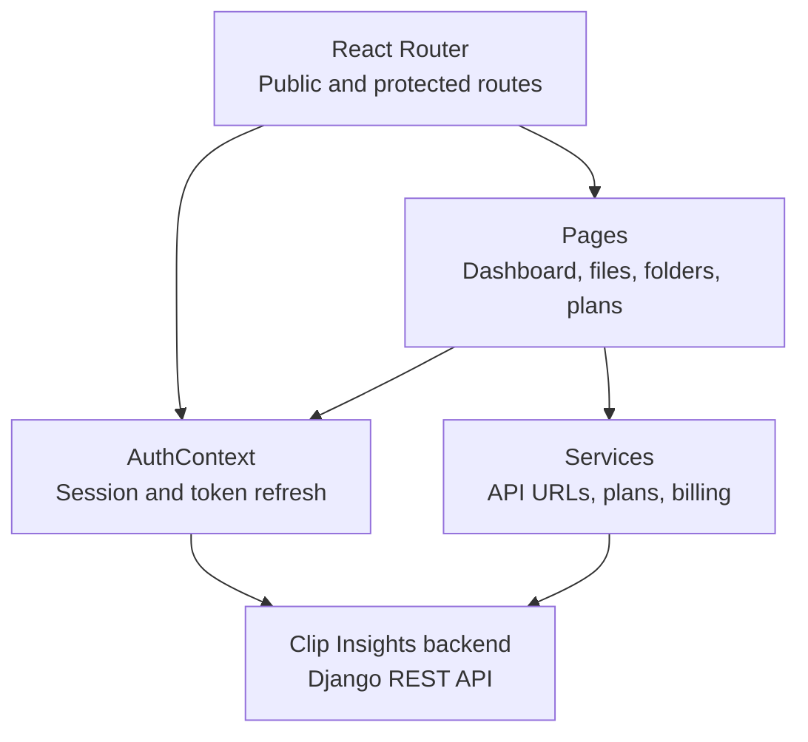

# Web app architecture

The [Clip Insights web app](https://app.clipinsights.org) is the account dashboard for documents saved from the browser extension. It is a React 18 single-page application built with Vite, JavaScript, and Tailwind CSS.

## Application flow

## Code map

| Location | Responsibility |
| --- | --- |
| `src/routes/routes.jsx` | Route definitions and `AuthGuard` for account pages. |
| `src/layouts` | Shared page shells. |
| `src/pages` | Authentication, dashboard, files, folders, and pricing screens. |
| `src/components` | Shared controls, file/folder cards, navigation, and usage widgets. |
| `src/context/AuthContext.jsx` | Session state, login/logout, access-token renewal, authenticated requests. |
| `src/services/apiService.js` | API URL construction, token encoding helpers, and shared utilities. |
| `src/services/planService.js` | Plan catalog and account usage requests. |
| `src/services/billingService.js` | Billing requests. |
| `src/services/paddle.js` | Paddle checkout script initialization and checkout events. |

## Authentication

Email/password and Google sign-in return backend JWT credentials. `AuthContext` stores encoded access and refresh tokens in browser local storage, exposes session state, and clears the local session on logout. Client-side encoding is obfuscation; it does not make browser-held credentials secret.

Authenticated requests obtain a valid access token before sending. Concurrent refresh requests share one in-flight operation. A 401 response triggers one refresh-and-retry attempt; failed refresh clears the session. Protected routes wait for session initialization before showing account content or redirecting to sign-in. Backend authorization remains authoritative.

## Documents and account data

The browser extension creates and uploads PDFs. This web app lists the saved files, supports folder organization, and shows storage and plan usage. The backend owns file validation, quotas, database metadata, and S3 access. The dashboard reads plan values from the API rather than defining the allowance rules itself.

Pricing and checkout use the backend plan and billing endpoints. Paddle's browser client opens checkout; the backend handles billing state.

## Configuration and build

`getApiUrl` uses `http://localhost:8000/api/` in development and `VITE_API_URL` as the backend base URL in production. `VITE_GOOGLE_CLIENT_ID` configures the Google sign-in provider. Vite substitutes these values at build time; browser environment variables must contain only public configuration.

`npm run build` produces `dist/`. The SPA rewrite in `vercel.json` sends deep links to `index.html`. Local build and lint commands are listed in the [README](./README.md).

See the [system architecture](https://github.com/Clip-Insights/.github/blob/main/docs/ARCHITECTURE.md) for the complete extension-to-document workflow.
