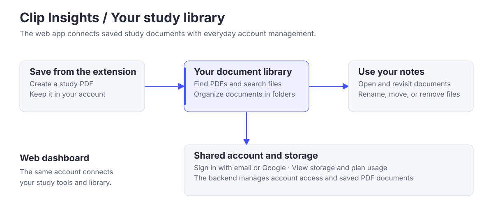

# Clip Insights · Web app

### Your video study library, in one place.

Find the PDFs saved from your Clip Insights study sessions, organize them into folders, and keep track of your account.

[Open web app](https://app.clipinsights.org) · [Website](https://clipinsights.org) · [Install extension](https://chromewebstore.google.com/detail/ccgechmifoecebnimnccgahnoklklilj)

## What you can do

| Your library | Your account |
| --- | --- |
| Browse and search saved PDFs. | Sign in with email or Google. |
| Create folders, rename documents, and move files. | View storage usage and available space. |
| Open or remove documents as your library grows. | Review plans, allowances, and subscription details. |

## How it fits together



The extension creates the study PDF; this dashboard is where you find and organize it. Both use the same backend, so your saved documents, account, and plan information belong to one workspace.

## Built with

**React 18 · JavaScript · Vite · Tailwind CSS · React Router**

A shared session layer handles sign-in and token renewal. Document storage, authorization, and account allowances are managed by the backend.

## Run locally

Use Node.js 22 and a configured Clip Insights backend. See the [development guide](./docs/DEVELOPMENT.md) for environment setup.

```bash
npm ci
npm run dev
```

Use `npm run build` to create the static application bundle.

## Explore further

[Detailed architecture](./ARCHITECTURE.md) · [Development and verification](./docs/DEVELOPMENT.md) · [Contributing](./AGENTS.md)

Part of [Clip Insights](https://github.com/Clip-Insights): [Chrome extension](https://github.com/Clip-Insights/chrome-extension) · [backend](https://github.com/Clip-Insights/backend) · [public website](https://github.com/Clip-Insights/main-site).
